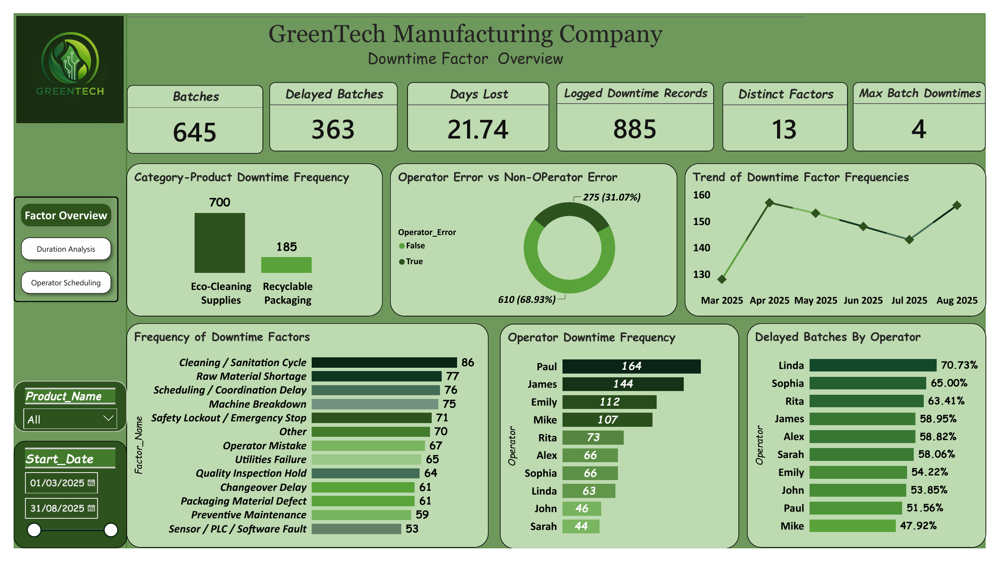
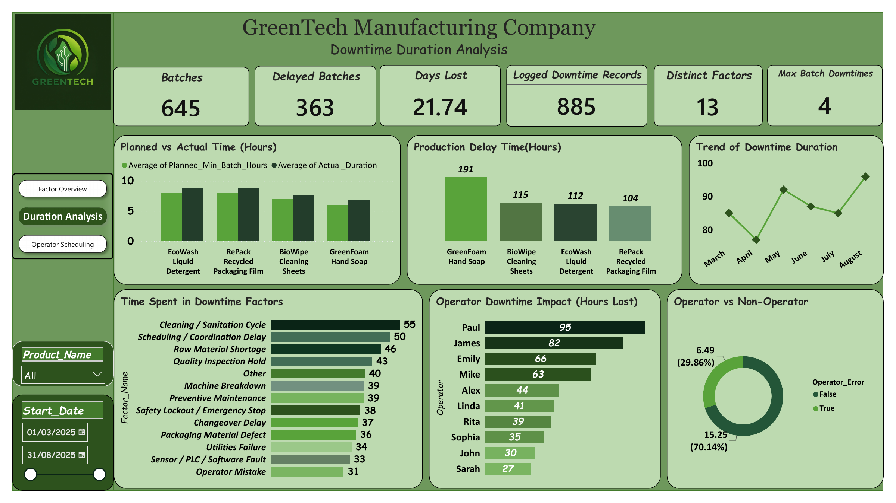
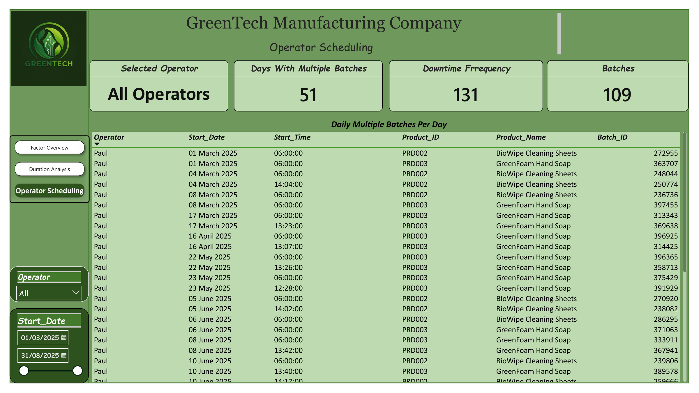

# GreenTech Manufacturing Downtime Analysis

### Understanding where production time is lost and where operational improvements should begin

Production delays can look like a machine problem until the underlying records tell a different story.

For this project, I analysed GreenTech’s production batches and downtime records to understand which interruptions occurred most often, which consumed the most time, and how production scheduling and operator assignments influenced the patterns.

Using SQL Server and Power BI, I connected the detailed records to three dashboard pages and an executive presentation, translating the findings into practical priorities for operations management.

[View Executive Presentation](presentation/presentation_GreenTech_Downtime_Analysis.pdf) · [Explore SQL Analysis](sql/sql_GreenTech_Manufacturing_Analysis.sql) · [Download Power BI Report](power-bi/GreenTech_Downtime_Analysis.pbix)

## Business Questions

The analysis focused on five questions:

1. How much production time was lost during the reporting period?
2. Which downtime factors occurred most frequently?
3. Which products and factors accounted for the greatest time losses?
4. How did downtime vary across operators and months?
5. Where should management investigate scheduling, process and maintenance improvements?

## Project Scope

| Area | Coverage |
|---|---|
| Reporting period | March–August 2025 |
| Production batches | 645 |
| Batches with recorded downtime | 363 |
| Logged downtime records | 885 |
| Positive-duration downtime events | 875 |
| Distinct downtime factors | 13 |
| Recorded downtime | 31,310 minutes, approximately 521.83 hours |
| Dashboard pages | 3 |
| Tools | SQL Server, Power BI, Power Query and DAX |

**Counting rule:** the 885 logged records include 10 zero-minute entries. The SQL event analysis excludes these entries when counting positive-duration downtime events. The dashboard’s “Logged Downtime Records” card retains the full logged count.

**Time convention:** 521.83 hours equals approximately 21.74 continuous 24-hour days. This is accumulated downtime, rather than a count of calendar days when the factory was closed.

## Data Sources

Four datasets supported the analysis:

| Dataset | Purpose |
|---|---|
| `line_productivity_batches.csv` | Production batches, dates, operators and recorded production timings |
| `line_downtime.csv` | Downtime durations recorded against batches and factors |
| `downtime_factors.csv` | Downtime factor descriptions and classifications |
| `products.csv` | Product details and production benchmarks |

[Browse the source datasets](data/)

## Analytical Approach

### 1. Validate the source records

I used SQL checks to examine record counts, missing values, duplicate identifiers and relationships between the source tables. I also reconciled the downtime totals and separated zero-minute entries from positive-duration events.

### 2. Prepare the analytical views

The SQL script creates two views:

- `dbo.vw_GreenTech_DowntimeEvents` brings downtime records into an event-level structure for analysis.
- `dbo.vw_GreenTech_MasterAnalysis` combines production, product and downtime information for business analysis.

Maintaining a distinction between batch-level and event-level records helps prevent production batches from being counted repeatedly when they have several downtime factors.

### 3. Build the reporting model

In Power BI, I developed measures and visuals to compare downtime frequency, duration, product performance and operator scheduling. Product and date filters allow users to investigate specific parts of the reporting period.

### 4. Translate findings into decisions

I compared frequent interruptions with lengthy interruptions, then used those differences to identify where process reviews, maintenance checks and scheduling investigations would be most useful.

## Key Findings

### More than half of the batches recorded downtime

Of the 645 production batches, 363 recorded downtime, approximately **56.28%**. Interruptions therefore affected a substantial share of production activity.

### Cleaning and coordination deserve early attention

Cleaning / Sanitation Cycle had the highest logged frequency at **86 records** and accounted for approximately **55 hours** of downtime.

Scheduling / Coordination Delay accounted for approximately **50 hours**, while Raw Material Shortage contributed approximately **46 hours**.

These findings support reviewing cleaning procedures, production handovers and material readiness alongside equipment maintenance.

### GreenFoam Hand Soap accounted for the most downtime hours

GreenFoam Hand Soap recorded approximately **191 hours** of downtime, ahead of the other products.

This identifies an area for investigation. It does not, by itself, establish that the product is less efficient: production volume, batch duration and operating conditions also affect total downtime.

### Operator-related classifications explain only part of the recorded loss

The duration analysis attributes approximately **29.86%** of downtime to factors classified as operator-related and **70.14%** to non-operator factors.

Operator coaching may help, but it should sit alongside improvements to materials, equipment, coordination and production processes.

### Frequency and duration tell different stories

April had the highest logged downtime frequency, while August had the greatest downtime duration.

Management should therefore monitor both the number of interruptions and the time lost. A lower event count does not necessarily mean a lower operational impact.

### Operator comparisons require workload context

Paul had the highest recorded downtime frequency and total downtime hours. Linda had the highest proportion of delayed batches.

These are different measures. Neither should be treated as an individual performance verdict without considering batch volume, product assignments, shift conditions and the causes of the interruptions.

## Dashboard Previews

### 1. Downtime Factor Overview

Shows the scale of recorded downtime, factor frequencies, monthly patterns, product categories and operator comparisons.

### 2. Downtime Duration Analysis

Examines time lost by product, downtime factor and operator, alongside planned versus actual production duration.

### 3. Operator Scheduling

Supports investigation of days with multiple batch assignments and the associated batch records.

The cards on this page describe its scheduling-focused scope. They should not be compared directly with the full production totals without checking the underlying filters and measure definitions.

The static preview shows the first visible rows. In Power BI Desktop, scroll within the table or use the Operator slicer to explore additional operators.

## Recommended Actions

| Priority | Recommended action | What to monitor |
|---|---|---|
| Cleaning and changeovers | Review cleaning steps and preparation activities while maintaining required safety and quality standards | Cleaning downtime per batch and repeat interruptions |
| Scheduling and coordination | Review batch sequencing, handovers and multiple assignments | Coordination delays and assignment overlaps |
| Material readiness | Confirm material availability before scheduled production starts | Material-shortage events and hours lost |
| Equipment reliability | Investigate recurring breakdowns and utility interruptions | Breakdown frequency, duration and recurrence |
| Operator support | Use cause-specific coaching and compare operators within similar workloads | Downtime per batch, product mix and repeat causes |
| Management reporting | Review frequency and duration together at regular operations meetings | Total downtime hours, affected-batch rate and leading causes |

These are proposed improvement actions. The project does not claim realised savings or productivity gains from implementation.

## Interpretation and Limitations

- Logged downtime records and positive-duration events use different counting rules.
- Operator comparisons describe associations; they do not establish who caused an interruption.
- Total downtime should be interpreted alongside production volume and product mix.
- Multiple batch assignments identify schedules worth reviewing; they do not automatically prove a scheduling conflict.
- Financial savings require validated cost assumptions and implementation evidence.
- The analysis covers the supplied reporting period and should not be treated as a forecast.

## Repository Contents

| Folder | Contents |
|---|---|
| [data](data/) | Four source CSV datasets |
| [sql](sql/) | SQL Server validation, transformation and analysis script |
| [power-bi](power-bi/) | Power BI report file |
| [presentation](presentation/) | Executive findings and recommendations |
| [images](images/) | Dashboard preview images |

## How to Explore the Project

**For a quick overview:** review the dashboard previews and executive presentation.

**For the technical analysis:** open the SQL script and inspect the validation checks, views and analytical queries.

**For interactive exploration:** download the Power BI file and open it in Power BI Desktop. Refreshing the report may require updating the source paths or database connection to match your environment.

**To reproduce the SQL analysis:** import the four CSV files into SQL Server, check that the database, table names and column types match the script, then run the script in order.

## Author

**Evangelista Emelogu**  
Data Analyst Consultant | Operations and Business Performance

[LinkedIn](https://www.linkedin.com/in/evangelistaemelogu/) · [GitHub](https://github.com/evangelemelogu)
